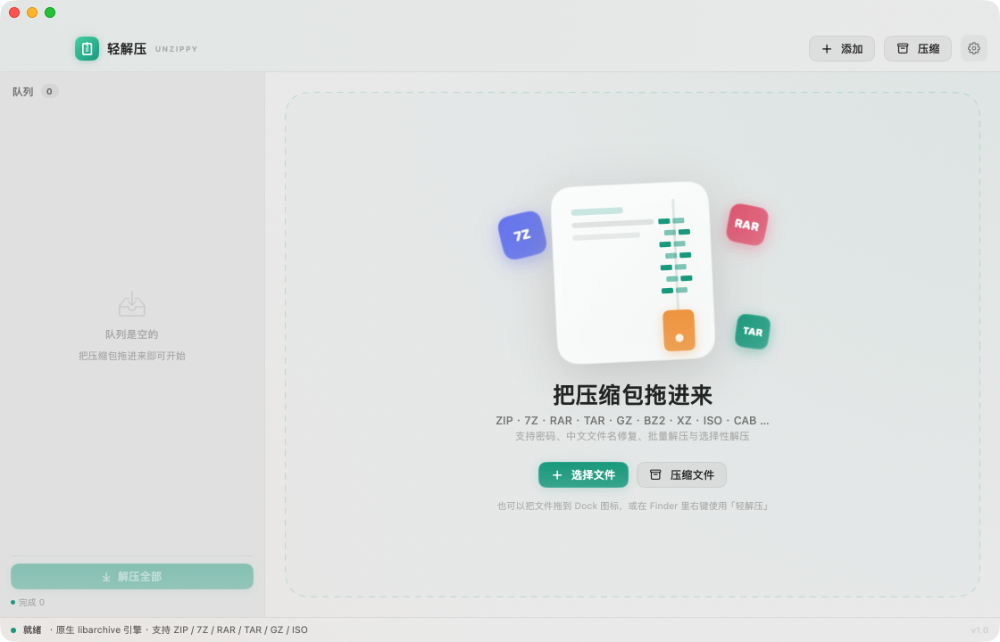
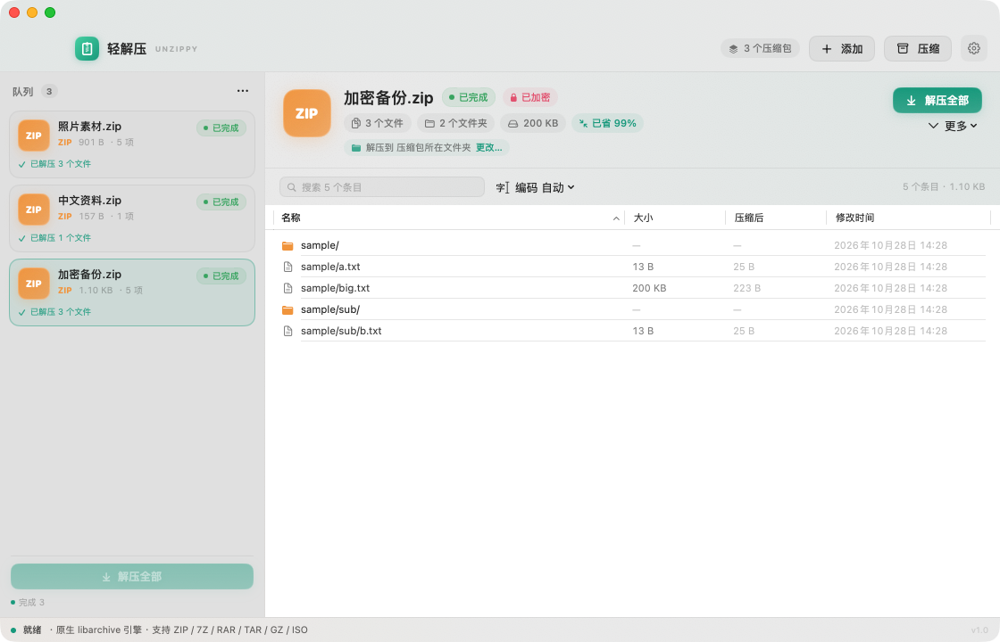
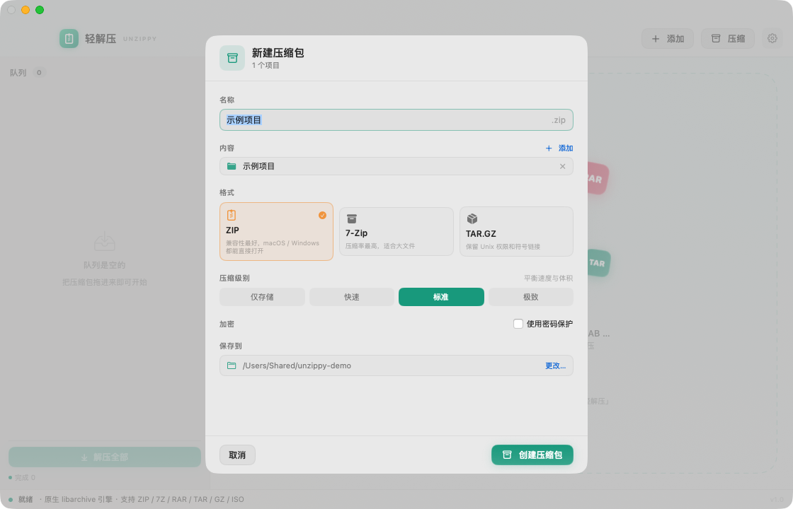
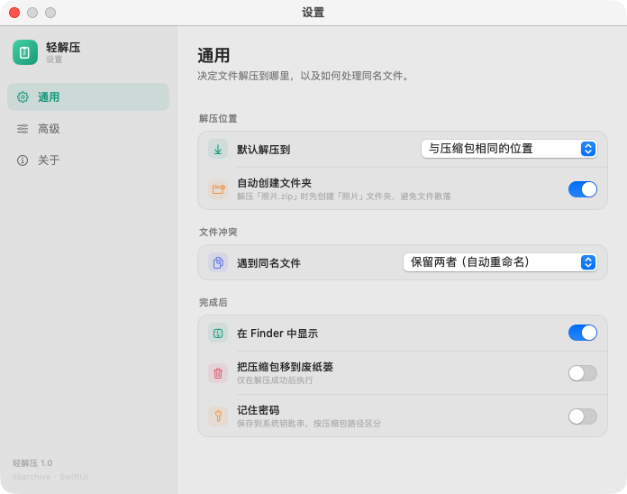

# 轻解压 · Unzippy

一个原生、安静、低占用的 macOS 解压工具。没有 Electron，没有后台常驻服务，也没有遥测。





## 轻量化实测

| 指标 | 实测 |
| --- | --- |
| 空闲常驻内存（phys_footprint） | 约 **32 MB** |
| 解压 128 MB / 6000 个文件时峰值 | 约 **70 MB** |
| 安装包体积（Universal，arm64 + x86_64） | **约 7.5 MB** |
| 后台进程 / 守护进程 | 无 |
| 网络请求 | 无 |

解压采用 libarchive 的流式接口，文件内容以 256 KB 块读写，不会整包载入内存。

## 功能

### 解压
- **格式**：ZIP、7Z、RAR、TAR、TAR.GZ、TAR.BZ2、TAR.XZ、GZ、BZ2、XZ、ISO、CAB、CPIO、XAR、LHA、JAR、APK、CBZ、CBR 等。
- **密码**：支持 ZIP（含 AES-256 / ZipCrypto）、7Z、RAR 加密包；错误密码会提示重试，可保存到钥匙串。
- **中文文件名修复**：Windows 生成的 GBK ZIP 会自动识别并还原中文名；也支持手动切换 GB18030 / Big5 / Shift-JIS / CP437。
- **选择性解压**：浏览压缩包内容，搜索、排序、多选后只解压需要的文件。
- **批量队列**：拖入多个压缩包，一键排队解压；单个失败不会阻塞其余任务。
- **冲突策略**：自动重命名（默认）、覆盖、跳过。
- **保留属性**：权限、修改时间、符号链接（仅限目标目录内部）、去除 quarantine。
- **安全**：拒绝 `../` 路径穿越、绝对路径、指向目标目录外的符号链接和硬链接。

### 压缩
- ZIP / 7-Zip / TAR.GZ 三种格式，压缩级别 0–9。
- ZIP 支持 **AES-256 密码保护**（兼容 7-Zip、Keka、The Unarchiver；旧版 Windows 资源管理器可能不支持 AES）。
- 自动跳过 `.DS_Store`，保留目录结构、权限与符号链接。



### 系统集成
- 支持「打开方式」和 Finder 右键服务：**用轻解压打开** / **用轻解压压缩**。
- 拖拽到窗口或 Dock 图标即可。
- 内置命令行工具 `Contents/Helpers/unzippy-cli`，支持 `list` / `extract` / `create`。



## 使用

1. 打开 `轻解压.app`。
2. 把压缩包拖进窗口，或点击「添加」。
3. 单击队列里的压缩包查看内容，点「解压全部」或选中条目后「解压所选」。
4. 默认解压位置和冲突策略可以在「设置」里调整（⌘,）。

## 构建

要求：macOS 14+、Xcode 命令行工具（Swift 5.9+）。

```bash
# 构建 Release 版本（Universal）
./scripts/build-app.sh release

# 构建并安装到 /Applications
./scripts/install.sh
```

产物位于 `build/轻解压.app`。应用使用 ad-hoc 签名，首次在其他 Mac 上打开时请右键 →「打开」。

## 架构

```
Sources/
  CArchive/          macOS 系统 libarchive 的手写 Swift 绑定
  UnzippyCore/       解压/压缩引擎（无 UI 依赖）
    ArchiveReader     流式读取、密码、编码修复、格式识别
    ArchiveExtractor  路径安全、冲突策略、权限、进度
    ArchiveWriter     ZIP / 7Z / TAR.GZ 创建（含 ZIP AES-256）
    ZipCentralDirectory  读取 ZIP 中央目录，修复 GBK 文件名与压缩后大小
  Unzippy/           SwiftUI 界面
  UnzippyCLI/        命令行工具
```

几个关键设计：

- **不打包第三方解压器**：直接链接 macOS 自带的 libarchive（`/usr/lib/libarchive.dylib`），应用只有 7 MB。
- **ZIP 文件名问题**：libarchive 对无 UTF-8 标记的 ZIP 会按 CP437 解码，中文会变乱码。因此本项目自己解析 ZIP 中央目录，用原始字节尝试 UTF-8 / GB18030 解码；写 ZIP 时强制设置 UTF-8 标记。
- **安全边界**：每个条目都规范化路径，拒绝 `..` 和绝对路径；符号链接只在指向解压根目录内部时创建；写入前用 `realpath` 校验父目录仍在根目录内。
- **UI 与引擎分离**：引擎是纯 Swift、可单测的库；UI 只负责队列、进度轮询和系统集成。

## 冒烟测试

```bash
./scripts/smoke-test.sh
```

覆盖：ZIP / 7Z / TAR.GZ / GZ / BZ2 / XZ 读写、加密 ZIP、GBK 中文名、路径穿越防护、符号链接逃逸、冲突重命名、权限保留。

## 已知限制

- macOS 系统 libarchive 的 ZSTD 过滤器需要外部 `zstd` 程序，应用会给出明确提示；ZSTD 不在支持列表中。
- 不支持分卷压缩包（`.z01`、`.part1.rar` 等）。
- 只能读取 RAR，不能创建 RAR。
- AES ZIP 在旧版 Windows 资源管理器 / Info-ZIP 中可能无法打开，请使用 7-Zip、Keka 或本应用。
- 应用完全离线，不会上传任何文件或密码。

## 隐私

不联网、不收集数据、不请求通讯录/位置等权限。密码仅在用户勾选「记住密码」时写入 macOS 钥匙串。

---

© 2026 Samuel. 仅供个人使用。底层解压由 macOS 自带的 libarchive（BSD 许可）完成。
